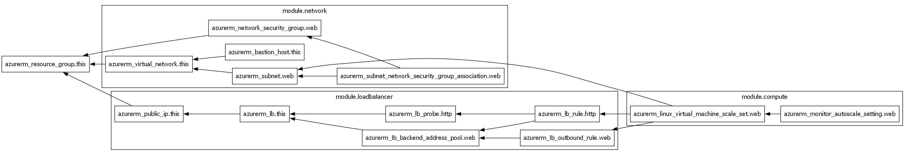
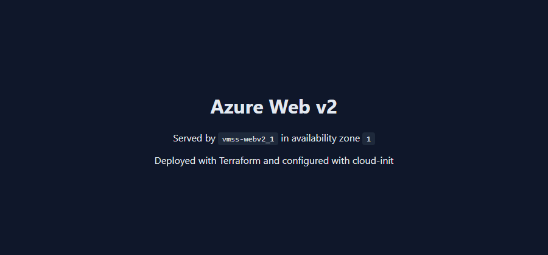
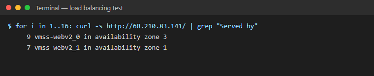
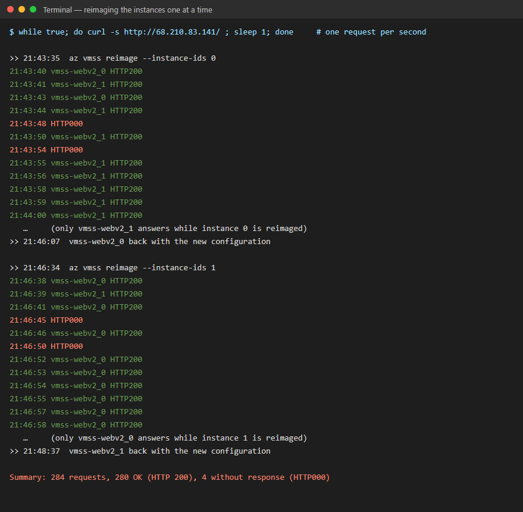

# Azure Web Infrastructure v2: Terraform Modules, Scale Set and CI

Follow-up to my final ASIR project, [Azure Web Infrastructure with Terraform and Wazuh](https://github.com/Perle46/azure-web-infrastructure-terraform-wazuh). That project was built by a team of three: first by hand in the Azure portal, then imported into Terraform. This one is an individual project, written in Terraform from scratch and using what the first project taught me.

## What changed from v1

| | v1 (final project) | v2 (this repository) |
|---|---|---|
| Terraform | One `main.tf` generated by importing resources created in the portal | Written from scratch, split into `network`, `loadbalancer` and `compute` modules |
| State | Local `terraform.tfstate` | Remote state in Azure Storage, with versioning and Entra ID authentication |
| Compute | 1 VM | VM Scale Set: 2–3 instances spread across 2 availability zones, CPU autoscaling |
| Configuration | Apache and the website installed by hand | cloud-init installs and hardens Apache on every new instance |
| SSH | Open on the public IP; removed by hand after Wazuh showed 2,112 failed logins in 22 h | Never exposed: no SSH rule, no public IPs on instances, optional Azure Bastion |
| Updates | Manual | Rolling upgrades checked by the health probe, automatic repair of unhealthy instances, daily security updates |
| Quality | None | GitHub Actions: `terraform fmt`, `validate`, TFLint and Checkov on every push |

## Architecture

```
                 Internet
                    │ HTTP 80
                    ▼
     Public IP (Standard, zone-redundant)
                    │
     Load Balancer (Standard) ── HTTP probe on /
       • rule: 80 → 80   (no other inbound rule)
       • outbound rule for the instances (apt updates)
                    │
  ┌─────────────────┼──────────────────┐  VNet 172.16.0.0/16
  │ snet-web 172.16.1.0/24 · NSG: HTTP from Internet only
  │                 │                  │  no default outbound access
  │      ┌─────────┐   ┌─────────┐
  │      │ zone 1  │   │ zone 3  │     VM Scale Set (Ubuntu 24.04, B2ats_v2)
  │      │ Apache  │   │ Apache  │     2–3 instances, autoscale on CPU
  │      └─────────┘   └─────────┘     configured by cloud-init
  └────────────────────────────────────┘
        ▲
        └── optional: Azure Bastion (Developer) for SSH

  rg-tfstate: Storage account (ZRS, versioning, no shared keys) ── Terraform state
```

Region: **Austria East**. The student subscription only allows five European regions. France Central (used in v1) does not offer B-series VMs to it, and Spain Central returned `OverconstrainedZonalAllocationRequest` (no capacity for the size in those zones) on two attempts. In Austria East the B-series is available in zones 1 and 3, which is enough to survive the loss of one zone. The Terraform state stays in Spain Central.

## Repository structure

```
bootstrap/                 storage account for the remote state (run once)
infra/
  main.tf                  resource group and the three modules
  variables.tf, outputs.tf
  cloud-init.yaml          Apache, hardening, automatic security updates, status page
  modules/
    network/               VNet, private subnet, NSG, optional Bastion
    loadbalancer/          public IP, load balancer, probe, HTTP and outbound rules
    compute/               VM Scale Set, rolling upgrades, autoscale
.github/workflows/         CI pipeline
```

## Security decisions

- **No SSH from the internet.** The load balancer only forwards port 80, the instances have no public IPs and the NSG only allows HTTP. SSH is only reachable through Azure Bastion when `enable_bastion = true`. This applies the main lesson from the Wazuh analysis in v1.
- **Private subnet.** `default_outbound_access_enabled = false`. The instances reach the internet for updates only through an explicit outbound rule on the load balancer.
- **Hardened web servers.** cloud-init hides the Apache version and OS (`ServerTokens Prod`), disables `TRACE` and turns on daily unattended security updates.
- **State without storage keys.** The state storage account has shared keys disabled. Terraform authenticates with Entra ID (`use_azuread_auth`) through a `Storage Blob Data Contributor` role assignment. Versioning keeps every previous state.
- **No secrets in the repository.** The subscription comes from `ARM_SUBSCRIPTION_ID`. The SSH public key and backend settings live in `terraform.tfvars` and `backend.hcl`, which Git ignores.

### Checkov results

21 checks passed, 0 failed. Eight checks are skipped on purpose, each with its reason written next to the resource:

| Check | Resource | Reason |
|---|---|---|
| CKV_AZURE_160 HTTP open to the internet | NSG | It is a public website; HTTPS needs a domain and certificate (next step) |
| CKV_AZURE_97 Encryption at host | Scale set | Needs a subscription feature registration; disks are already encrypted at rest |
| CKV_AZURE_59 Public network access | State storage | Used from the admin PC; access requires Entra ID because keys are disabled |
| CKV2_AZURE_33 Private endpoint | State storage | Would need a VPN or self-hosted runner |
| CKV2_AZURE_1 Customer-managed key | State storage | Platform encryption is enough for a lab; CMK needs a Key Vault |
| CKV_AZURE_206 Geo-replication | State storage | ZRS already keeps three copies across zones |
| CKV_AZURE_33 / CKV2_AZURE_21 Logging | State storage | Queues unused; blob logging needs Log Analytics, versioning covers recovery |

## CI pipeline

[`terraform-ci.yml`](.github/workflows/terraform-ci.yml) runs on every push and pull request, with no Azure credentials:

1. `terraform fmt -check` for consistent formatting
2. `terraform init -backend=false` and `terraform validate` for `bootstrap/` and `infra/`
3. **TFLint** with the recommended Terraform rules
4. **Checkov** security scan

## Deployment

Requirements: Azure CLI, Terraform ≥ 1.9 and an SSH key pair. PowerShell:

```powershell
az login
$env:ARM_SUBSCRIPTION_ID = az account show --query id -o tsv

# 1. Remote state (once)
cd bootstrap
terraform init
terraform apply
terraform output -raw backend_config | Set-Content ..\infra\backend.hcl -Encoding ascii

# 2. Infrastructure
cd ..\infra
copy terraform.tfvars.example terraform.tfvars   # paste your SSH public key
terraform init -backend-config=backend.hcl
terraform plan -out tfplan
terraform apply tfplan
terraform output website_url

# 3. Clean up
terraform destroy
```

The role assignment for the state can take a few minutes to apply. If `terraform init` in `infra/` returns a 403 error, wait and try again.

## Results

Deployed on 6 October 2026 in Austria East: 13 resources in about 2 minutes, on top of the state storage created by `bootstrap/`.



*Dependency graph generated with `terraform graph | dot -Tpng`, grouped by module.*

**Load balancing across zones.** Each instance writes its own name and availability zone into the page (from the Azure Instance Metadata Service), so every refresh shows which instance answered:

 



**Problems found during deployment**

- **No capacity in Spain Central.** The scale set failed twice with `OverconstrainedZonalAllocationRequest` for `B2ats_v2` in zones 2 and 3, so the web tier moved to Austria East (zones 1 and 3).
- **Resource group recreated with the same name.** Moving region deleted `rg-webv2` and created it again right away. For several minutes Azure returned a mix of the old and new resources, which share the same IDs. The region is now part of the resource group name (`rg-webv2-austriaeast`), so a region change never reuses an ID that is still being deleted.
- **Apache version still visible.** The `Server` header showed `Apache/2.4.58 (Ubuntu)`. Apache loads `conf-enabled/` alphabetically, and its own `security.conf` (`ServerTokens OS`) overrode my `hardening.conf`. Renaming the file to `zz-hardening.conf` fixed it. The header is now `Server: Apache`.

**Updating the instances without downtime.** cloud-init only runs on first boot, so after the Apache fix the instances were reimaged one at a time while a request was sent every second:



280 of 284 requests succeeded. The 4 failures happened in the first seconds of each reimage, before the 5-second health probe marked the instance as down. A shorter probe interval, or removing the instance from the backend pool before reimaging, would close that gap.

## Next steps

- HTTPS with a domain and certificate (Application Gateway or Let's Encrypt).
- Install the Wazuh agent through cloud-init so every new instance is monitored from its first boot.
- Deploy from GitHub Actions with OIDC (federated credentials, no stored secrets) and a manual approval step.
- Azure Monitor alerts for unhealthy instances and scaling events.
